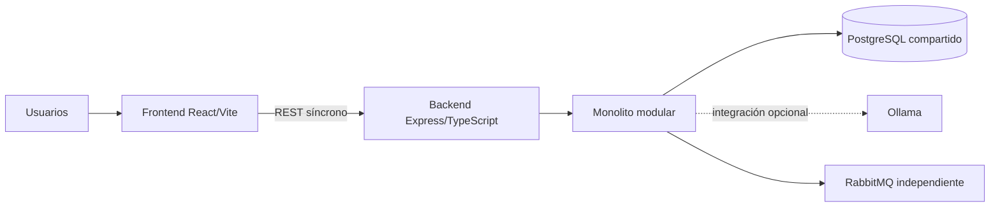
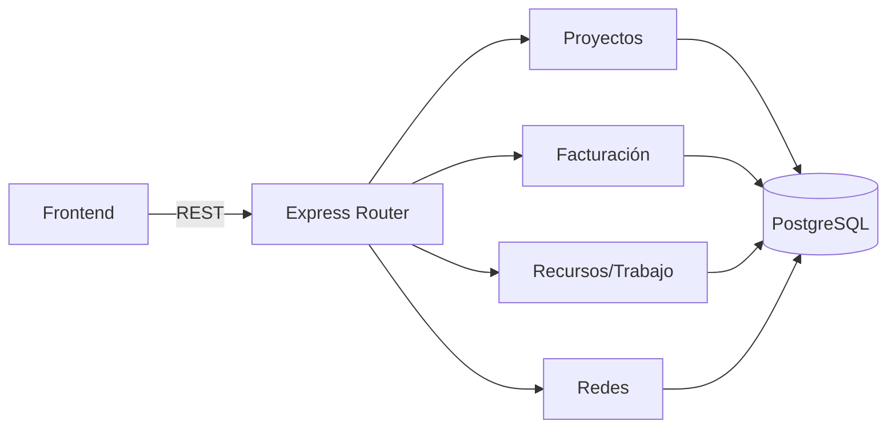
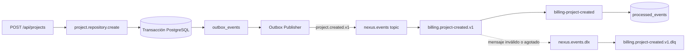
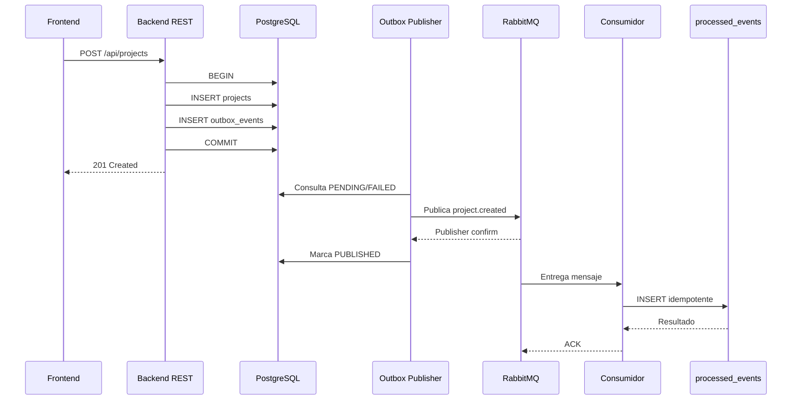
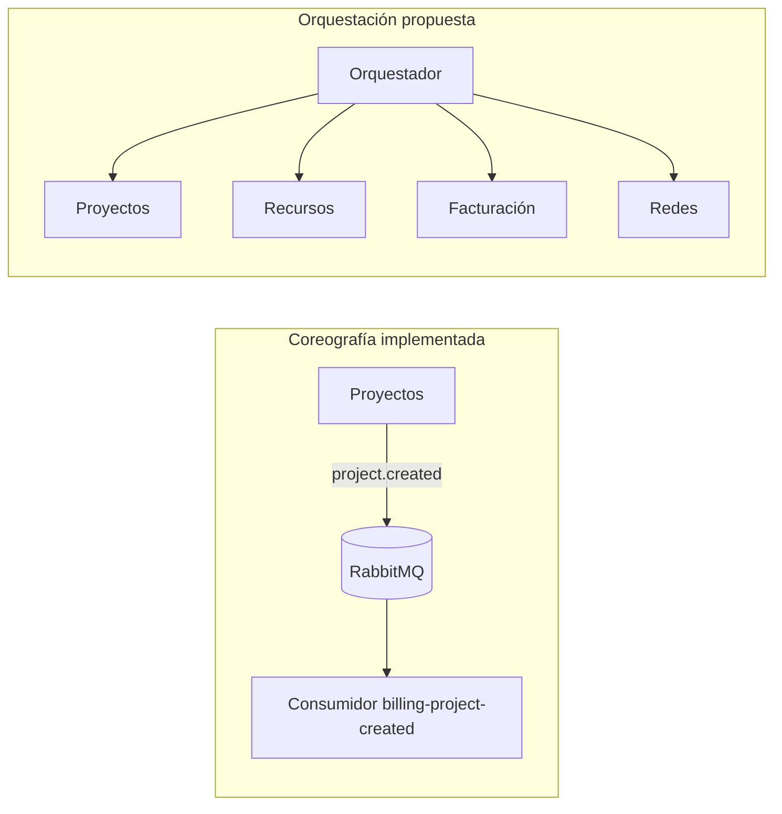
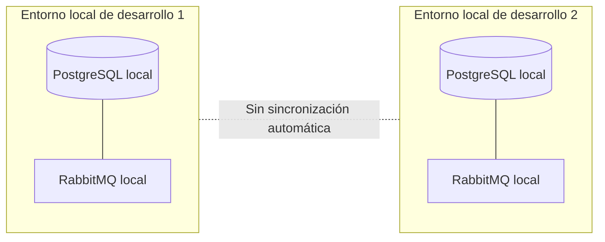
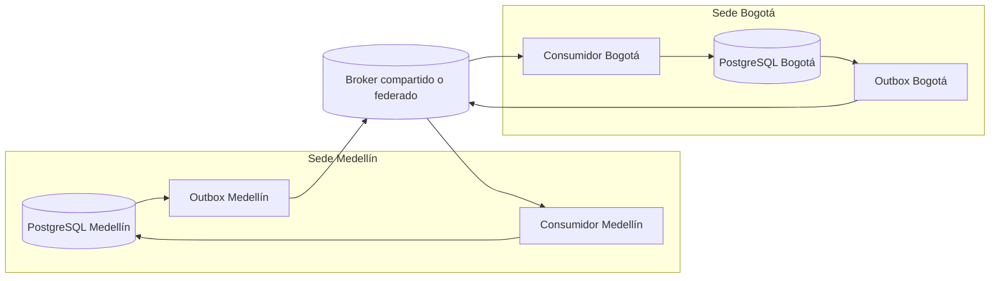

# RT1 — Sistemas Distribuidos, Arquitectura Distribuida y Mensajería

## 1. Introducción y alcance

Este documento consolida la respuesta técnica de Nexus Safe-Cloud al Requisito Técnico 1 del Corte 3. Describe la arquitectura implementada en el MVP, el flujo asíncrono con RabbitMQ, los mecanismos de confiabilidad, las decisiones de coreografía y las evoluciones propuestas.

El alcance incluye los dominios de Proyectos, Facturación, Recursos y Redes. La solución actual es un monolito modular con PostgreSQL compartido y RabbitMQ como servicio independiente conectado al backend para un flujo asíncrono concreto; esto no constituye una arquitectura de microservicios independientes.

Los estados utilizados son:

- **Implementada:** existe en código y forma parte del MVP.
- **Implementada parcialmente:** existe el mecanismo, pero no cubre todo el flujo de negocio o requiere evidencia adicional.
- **Diseñada:** está definida como evolución, pero no está implementada.
- **No implementada:** no existe en el repositorio.

La selección del monolito modular es una decisión arquitectónica válida para el MVP: permite entregar los módulos aprobados, conservar reglas de negocio centralizadas y añadir mensajería donde aporta valor, sin asumir que los microservicios independientes sean obligatorios. La sincronización entre sedes, la separación de bases de datos y la extracción de microservicios pertenecen a evoluciones futuras, no al estado actual.

## 2. Arquitectura actual — AS-IS

### 2.1 Componentes

| Componente | Tecnología | Estado |
|---|---|---|
| Interfaz web | React, TypeScript y Vite | Implementada |
| API | Express y TypeScript | Implementada |
| Organización interna | Monolito modular | Implementada |
| Persistencia | PostgreSQL compartido | Implementada |
| Mensajería | RabbitMQ como servicio independiente integrado con el backend | Implementada |
| IA auxiliar | Ollama opcional | Implementada como integración auxiliar |
| Microservicios independientes | No existen | No implementados |
| Bases de datos por servicio | No existen | No implementadas |



### 2.2 Módulos funcionales

**Proyectos.** Sus rutas se registran en `backend/src/routes/index.ts` y su lógica principal está en `backend/src/controllers/project.controller.ts` y `backend/src/repositories/project.repository.ts`. Expone `GET /api/projects`, `POST /api/projects`, `PUT /api/projects/:id` y la consulta de usuarios responsables. La creación de un proyecto inserta el registro y su evento Outbox en una misma transacción.

**Facturación.** Sus rutas están en `backend/src/modules/billing/routes.ts` y su lógica en `backend/src/modules/billing/service.ts`. Gestiona hitos, facturas, emisión, pagos, anulación y aging. El consumidor `billing-project-created` registra la recepción del evento, pero no crea facturas ni modifica saldos.

**Recursos y operación.** El módulo `backend/src/modules/work/` gestiona órdenes de trabajo, responsables, horas y cambios de estado. Actualmente utiliza llamadas internas y PostgreSQL; no publica eventos RabbitMQ.

**Redes.** El módulo `backend/src/modules/network/` gestiona activos, enlaces, VLAN, sitios, topología, importaciones, hallazgos y campos personalizados. Actualmente opera dentro del mismo backend y no publica eventos RabbitMQ.

## 3. Comunicación síncrona mediante REST

### 3.1 Flujo real



Los módulos no se comunican mediante HTTP entre servicios independientes. Las dependencias se resuelven mediante llamadas internas a controladores, servicios, repositorios y PostgreSQL dentro del mismo proceso.

### 3.2 Operaciones síncronas

REST se conserva para operaciones que necesitan respuesta inmediata:

- Autenticación y sesiones.
- Consultas y creación de proyectos.
- Gestión de clientes y contratos.
- Creación y actualización de órdenes de trabajo.
- Registro de horas.
- Cierre de hitos.
- Emisión, pago y anulación de facturas.
- Consultas de activos, topología y dashboards.

La respuesta síncrona permite devolver validaciones, errores de autorización, identificadores y estado actualizado al usuario.

### 3.3 REST frente a gRPC

REST es suficiente para el MVP porque:

- Ya está implementado en Express.
- Es consumido directamente por React/Vite.
- Sus rutas son adecuadas para operaciones de negocio y consultas.
- Reduce dependencias y complejidad operativa.
- No existen microservicios internos que requieran comunicación binaria de baja latencia.

gRPC no está implementado ni se incorpora en esta etapa. Introducirlo requeriría nuevos contratos, generación de clientes, observabilidad y pruebas. No existe evidencia de que su beneficio justifique esa complejidad en el MVP.

## 4. Comunicación asíncrona mediante RabbitMQ

### 4.1 Flujo implementado

El flujo real está respaldado por:

- `backend/src/messaging/contracts.ts`
- `backend/src/messaging/outbox.ts`
- `backend/src/messaging/broker.ts`
- `backend/src/messaging/consumer.ts`
- `backend/src/messaging/runtime.ts`
- `backend/src/repositories/project.repository.ts`
- `database/scripts/19_Create_messaging.sql`
- `docker-compose.yml`



### 4.2 Componentes

| Elemento | Nombre o función | Estado |
|---|---|---|
| Exchange principal | `nexus.events` | Implementado |
| Tipo de exchange | `topic` | Implementado |
| Routing key | `project.created.v1` | Implementado |
| Cola | `billing.project-created.v1` | Implementada |
| Consumidor | `billing-project-created` | Implementado y probado |
| Dead Letter Exchange | `nexus.events.dlx` | Implementado |
| Dead Letter Queue | `billing.project-created.v1.dlq` | Implementada |
| Tabla Outbox | `outbox_events` | Implementada |
| Tabla de idempotencia | `processed_events` | Implementada |

El consumidor `billing-project-created` recibe el evento generado por el módulo de Proyectos, valida su estructura y contrato, y registra su procesamiento en la tabla `processed_events`. También contempla el tratamiento de mensajes duplicados mediante idempotencia.

Por tanto, existe una integración técnica asíncrona entre los contextos de Proyectos y Facturación, implementada y probada mediante RabbitMQ. Sin embargo, esta integración no representa una automatización completa de los procesos comerciales de Facturación, ya que el consumidor no crea hitos ni genera facturas automáticamente.

El evento `project.created` no contiene información suficiente para autorizar una operación de facturación, como el monto contractual aprobado, los hitos pactados, las condiciones comerciales o la autorización para emitir una factura.

Crear automáticamente un hito o una factura a partir de este evento implicaría asumir reglas de negocio que actualmente no están definidas en el contrato. Por esta razón, las operaciones financieras continúan realizándose mediante los procesos existentes del módulo de Facturación y permanecen fuera del alcance de este flujo de mensajería.

### 4.3 Secuencia de `project.created`



## 5. Contrato del evento

El contrato tipado está definido en `backend/src/messaging/contracts.ts`.

| Campo | Tipo | Propósito |
|---|---|---|
| `eventId` | UUID/string | Identificador único del evento |
| `eventType` | `project.created` | Tipo de evento |
| `eventVersion` | `1` | Versión del contrato |
| `occurredAt` | ISO timestamp | Momento de creación |
| `entityId` | UUID/string | Identificador del proyecto |
| `correlationId` | UUID/string | Trazabilidad de la operación |
| `payload.projectId` | UUID/string | Proyecto creado |
| `payload.code` | string | Código del proyecto |
| `payload.customerId` | UUID/string | Cliente asociado |
| `payload.status` | string | Estado inicial |
| `payload.estimatedBudget` | number/null | Presupuesto estimado |
| `payload.estimatedHours` | number/null | Horas estimadas |

El contrato no transmite contraseñas, tokens ni credenciales. La versión está preparada para evolución; un cambio incompatible debe utilizar otra versión del evento.

La validación del consumidor comprueba que existan `eventId`, `eventType`, `entityId` y `payload`, y que el tipo sea `project.created`.

## 6. Confiabilidad y consistencia

### 6.1 Transactional Outbox

En `project.repository.ts`, el proyecto y el evento se insertan dentro de la misma transacción:

```text
BEGIN
  INSERT projects
  INSERT outbox_events
COMMIT
```

Si cualquiera de las operaciones falla, se ejecuta `ROLLBACK`. Esto evita confirmar un proyecto sin registrar su evento.

### 6.2 Publicación y estados

El publicador busca eventos con estado `PENDING` o `FAILED` y los publica mediante un canal de confirmación. Si la publicación es confirmada, marca el evento como `PUBLISHED`. Si falla, registra el error y programa un nuevo intento cinco segundos después.

### 6.3 ACK, NACK, reintentos y DLQ

El consumidor implementa mecanismos de confirmación y tratamiento de errores para evitar que los mensajes inválidos o que no puedan procesarse permanezcan indefinidamente en la cola principal.

| Situación | Comportamiento |
|---|---|
| JSON inválido | NACK sin reencolar; el mensaje se envía a la DLQ |
| Contrato inválido | NACK sin reencolar; el mensaje se envía a la DLQ |
| Procesamiento exitoso | ACK después de persistir el registro en `processed_events` |
| Evento duplicado | `ON CONFLICT DO NOTHING` y ACK |
| Error transitorio y contador menor al límite | Se republica el mensaje incrementando `x-retry-count` |
| Error al publicar el reintento | NACK con reencolado del mensaje original |
| Límite de reintentos alcanzado | NACK sin reencolar; el mensaje se envía a la DLQ |

El número máximo de reintentos se configura mediante la variable de entorno:

```text
RABBITMQ_MAX_CONSUMER_RETRIES=3
```

### 6.4 Idempotencia

`processed_events` tiene la clave primaria compuesta:

```sql
PRIMARY KEY (event_id, consumer_name)
```

La inserción utiliza `ON CONFLICT (event_id, consumer_name) DO NOTHING`. Si el mismo evento llega dos veces al consumidor, solo se conserva un registro y el duplicado recibe ACK sin producir un nuevo efecto.

### 6.5 Reconexión

`broker.ts` conserva el handler del consumidor y utiliza una promesa compartida de conexión. Cuando RabbitMQ se desconecta:

1. Limpia conexión y canales.
2. Restablece el indicador de consumidor registrado.
3. Reintenta la conexión.
4. Declara nuevamente exchange, colas y bindings.
5. Registra nuevamente `billing-project-created`.

La bandera `consumerRegistered` evita duplicar la suscripción en un mismo canal. La implementación está respaldada por código; las pruebas manuales realizadas se documentan en la sección 10.

## 7. Coreografía frente a orquestación

### 7.1 Comparación

| Criterio | Coreografía | Orquestación |
|---|---|---|
| Coordinador central | No | Sí |
| Acoplamiento | Menor entre productor y consumidor | Mayor con el orquestador |
| Trazabilidad | Requiere IDs, logs y trazas | Centralizada en el orquestador |
| Adecuada para | Eventos independientes | Procesos multietapa |
| Compensaciones | Distribuidas | Coordinadas |
| Estado actual | Implementada mínimamente | No implementada |
| Uso futuro | Nuevos eventos desacoplados | Flujos financieros complejos |



La coreografía es adecuada para el flujo actual porque Proyectos publica un evento y el consumidor registra la recepción sin generar una transacción financiera. La orquestación sería apropiada si se definiera un proceso obligatorio con validaciones, compensaciones y efectos coordinados entre proyectos, recursos y facturación.

## 8. Desacoplamiento de módulos

| Módulo | Comunicación actual | Mensajería actual | Evolución posible |
|---|---|---|---|
| Proyectos | REST y llamadas internas | Publica `project.created` | Eventos de avance, cierre o cambios relevantes |
| Facturación | REST y PostgreSQL compartido | Consume y registra `project.created` | Proyecciones o eventos de hitos/facturas |
| Recursos | REST y llamadas internas | No publica eventos | Eventos de asignación, capacidad u horas |
| Redes | REST y llamadas internas | No publica eventos | Eventos de cambios de activos, enlaces o hallazgos |

Los eventos futuros de Recursos y Redes son propuestas. No están implementados y no deben presentarse como evidencia actual del RT1.

## 9. Consistencia eventual entre sedes

### 9.1 Situación actual

Durante el desarrollo, cada integrante del equipo trabaja con una instancia local e independiente de PostgreSQL. La ejecución de los mismos scripts SQL permite mantener estructuras de base de datos equivalentes, pero no implica que los datos se compartan o sincronicen entre los entornos.

Asimismo, RabbitMQ se ejecuta como un servicio local dentro del entorno Docker Compose del proyecto. Por tanto, la configuración actual no proporciona comunicación ni sincronización automática entre bases de datos ubicadas en diferentes sedes geográficas.

Actualmente, el proyecto no implementa:

- Replicación geográfica de bases de datos.
- Un broker compartido o federado entre sedes.
- Consumidores remotos conectados a bases de datos de otras sedes.
- Resolución de conflictos entre actualizaciones realizadas en diferentes bases de datos.
- Mecanismos formales de propiedad y autoridad sobre los datos por sede.
- Sincronización automática de proyectos, facturas, recursos o redes entre ubicaciones.

La siguiente representación muestra la independencia de los entornos locales de desarrollo y la ausencia de sincronización entre ellos:



### 9.2 Arquitectura objetivo

Como evolución futura, se plantea una arquitectura distribuida que permita mantener bases de datos independientes por sede y sincronizar determinados cambios mediante mensajería asíncrona.

La propuesta contempla que cada sede disponga de su propia base de datos, un mecanismo Outbox para registrar los eventos asociados a sus transacciones y un broker compartido o federado que permita distribuir los eventos hacia los consumidores correspondientes.



Esta arquitectura es una propuesta de evolución y no se encuentra implementada en la versión actual del proyecto. Para desarrollarla sería necesario:

- Definir qué eventos pueden distribuirse entre las sedes y cuáles deben permanecer locales.
- Establecer la propiedad de los datos y determinar qué sede tiene autoridad para modificar cada entidad.
- Identificar el origen y destino de cada evento para evitar que un mensaje recibido se publique nuevamente como si fuera un evento originado localmente.
- Utilizar mecanismos de comunicación autenticada y cifrada entre los componentes.
- Mantener consumidores idempotentes para evitar aplicar varias veces un mismo evento.
- Evitar conexiones directas entre las bases de datos de las sedes.
- Evitar transacciones distribuidas y utilizar mecanismos de consistencia eventual.
- Definir políticas de ordenamiento, reproducción (*replay*) y retención de eventos.
- Establecer estrategias de resolución de conflictos cuando existan modificaciones concurrentes.
- Implementar mecanismos de monitoreo y recuperación ante desconexiones o fallos de comunicación.
- Realizar pruebas de desconexión, reconexión y sincronización posterior en cada sede.

La implementación de esta propuesta permitiría evolucionar desde el modelo centralizado de información hacia un esquema con bases de datos distribuidas y sincronización asíncrona. Sin embargo, requiere decisiones adicionales de arquitectura y reglas de negocio que superan el alcance de la implementación actual.

### 9.3 Despliegue inicial centralizado

Para el despliegue inicial del MVP se contempla una aplicación y una base de datos PostgreSQL centralizadas en la nube. Medellín, Bogotá y los colaboradores remotos consumirían la misma aplicación y la misma fuente de información.

Esta alternativa reduce la duplicidad de datos y no requiere replicación entre dos bases independientes. Es una arquitectura objetivo de despliegue; solo debe marcarse como implementada cuando exista evidencia del despliegue real.

La replicación asíncrona entre bases independientes por sede queda como evolución futura, si se requiere autonomía operativa local.

La implementación actual solo demuestra consistencia eventual entre el registro Outbox y el consumidor dentro del entorno del ERP, no consistencia geográfica.

## 10. Pruebas y evidencias de funcionamiento

Las siguientes pruebas manuales fueron realizadas según la evidencia de ejecución disponible para el equipo. Las capturas, consultas y logs se incorporarán posteriormente en los espacios indicados.

### Prueba 1. Creación de proyecto y publicación

1. Se creó un proyecto desde la aplicación.
2. Se verificó su registro en `outbox_events`.
3. Se comprobó que el evento `project.created` quedó en estado `PUBLISHED`.
4. Se verificó el registro correspondiente en `processed_events` con el consumidor `billing-project-created`.

**(Pendiente colocar evidencia)**

### Prueba 2. Reconexión de RabbitMQ

1. Se detuvo el contenedor RabbitMQ.
2. Se comprobó que el backend detectó la desconexión.
3. Se inició nuevamente RabbitMQ.
4. Se verificó la reconexión del backend y el registro del consumidor.
5. Se creó otro proyecto y se comprobó que el evento volvió a procesarse correctamente.

**(Pendiente colocar evidencia)**

### Prueba 3. Mensajes inválidos y DLQ

1. Se publicó un mensaje con JSON inválido.
2. Se comprobó que fue enviado a la DLQ.
3. Se publicó un JSON válido con contrato inválido.
4. Se comprobó que también fue enviado a la DLQ.

**(Pendiente colocar evidencia)**

### Prueba 4. Idempotencia

1. Se publicó dos veces el mismo evento de prueba.
2. Se verificó que la combinación `event_id` y `consumer_name` quedó registrada una sola vez.
3. Se comprobó que el duplicado fue ignorado y recibió ACK.

**(Pendiente colocar evidencia)**

### Pruebas automatizadas

Las pruebas existentes se encuentran en:

```text
backend/src/tests/
backend/src/modules/network/tests/
```

Las pruebas relacionadas directamente con mensajería son:

- `backend/src/tests/messaging.test.ts`: valida el contrato `project.created` y la ausencia de secretos.
- `backend/src/tests/messaging-resilience.test.ts`: valida el contador y el límite de reintentos.

También existen pruebas de autenticación, autorización, reglas de dominio, importadores y normalización de redes. Estas pruebas no convierten por sí solas el flujo RabbitMQ en una prueba de integración extremo a extremo.

**(Pendiente colocar evidencia)**

## 11. Estado de cumplimiento del RT1

| Capacidad | Estado |
|---|---|
| Backend modular | Implementada |
| Comunicación REST | Implementada |
| PostgreSQL compartido | Implementada |
| RabbitMQ local | Implementada |
| Evento `project.created` | Implementada |
| Transactional Outbox | Implementada |
| Consumidor `billing-project-created` | Implementada y probada |
| Registro en `processed_events` | Implementada |
| Idempotencia | Implementada |
| ACK/NACK | Implementada |
| Reintentos | Implementada |
| DLQ | Implementada y probada |
| Reconexión | Implementada y probada |
| Integración técnica Proyectos-Facturación | Implementada y probada |
| Automatización comercial de Facturación | No implementada; fuera del alcance actual |
| Eventos de Recursos | Diseñada como evolución futura |
| Eventos de Redes | Diseñada como evolución futura |
| Desacoplamiento mediante eventos de los cuatro módulos | Implementada parcialmente |
| Microservicios independientes | No implementados; no obligatorios bajo la arquitectura seleccionada |
| Base de datos centralizada para ambas sedes | Diseñada como arquitectura objetivo; pendiente de evidencia de despliegue |
| Replicación eventual entre dos bases independientes | No implementada |
| Orquestador distribuido | No implementado |

## 12. Conclusión

Nexus Safe-Cloud demuestra una base funcional de sistemas distribuidos mediante REST, RabbitMQ, Transactional Outbox, ACK/NACK, reintentos, DLQ e idempotencia para el evento `project.created`.

El alcance real debe presentarse con precisión: el sistema continúa siendo un monolito modular con PostgreSQL compartido y utiliza RabbitMQ como servicio de infraestructura independiente. El consumidor confirma la recepción del evento en `processed_events`, pero no genera facturas ni hitos ni actualiza información financiera. Recursos y Redes todavía no participan en flujos asíncronos, y no existe replicación entre bases independientes de Medellín y Bogotá.

Por tanto, el cumplimiento defendible del RT1 es parcial: existe comunicación REST síncrona y un flujo asíncrono confiable entre Proyectos y el contexto de Facturación dentro del MVP. La integración demuestra publicación, consumo, validación, idempotencia y manejo de errores sin generar operaciones comerciales automáticamente. Todavía no existen microservicios independientes, bases aisladas ni replicación eventual entre sedes. La aplicación y base de datos centralizadas en nube son una arquitectura objetivo de despliegue, pendiente de evidencia hasta su ejecución real.
