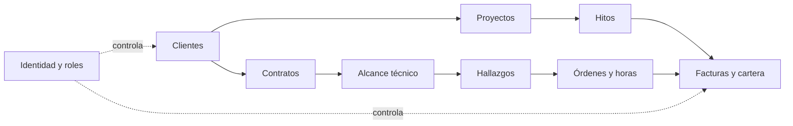

# Matriz de trazabilidad estratégica

## 1. Propósito

Esta matriz relaciona los problemas empresariales de Nexus Safe-Cloud con los objetivos estratégicos, las capacidades necesarias y los componentes del ERP que pueden habilitarlas.

Se manejan cuerts estados que permitiran identificar como esta actualmente cada punto en el sistema, los estadis se identifican así:

- **Implementado:** existe evidencia funcional en código, SQL o pruebas.
- **Parcial:** existe soporte, pero falta una parte relevante del objetivo.
- **Propuesto:** aparece en la arquitectura objetivo o en el Corte 1, sin evidencia completa en el repositorio.
- **Pendiente de validar:** requiere datos, decisiones o pruebas adicionales.

## 2. Matriz principal

| ID | Dolor o necesidad | Objetivo empresarial | Capacidad empresarial | Subsistema ERP | Componente o mecanismo | RF Corte 1 | Indicador o resultado esperado | Estado |
|---|---|---|---|---|---|---|---|---|
| D01 | Información fragmentada, duplicada o contradictoria entre sedes | Establecer una fuente única y confiable de información | Gobierno y calidad de datos | Clientes, proyectos, contratos, red y reportes | PostgreSQL central, claves, restricciones, `data_origin`, API REST | RF03, RF04 | Menos duplicados críticos; perfil único consultable | Parcial |
| D02 | Falta de visibilidad del estado de proyectos | Controlar avance, responsables, hitos y compromisos | Gestión de proyectos | Projects, dashboard, service contracts | Entidades de proyectos, estados, hitos, responsables y consultas REST | RF01, RF06, RF07 | Avance y hitos consultables por proyecto | Parcial |
| D03 | Falta de visibilidad de rentabilidad | Relacionar ingresos, esfuerzo y costos por proyecto | Gestión de desempeño de proyectos | Projects, Work, Billing, Procurement, Accounting | Horas, facturas, gastos y asientos relacionados | RF01, RF08, RF09 | Margen y desviación de horas por proyecto | Pendiente de validar |
| D04 | Compromisos comerciales sin conocer disponibilidad técnica | Alinear ventas con capacidad operativa | Gestión de recursos y capacidad | CRM, Projects, Work, HR | Clientes, oportunidades, responsables y horas | RF05, RF14, RF15 | Disponibilidad consultable antes de comprometer trabajo | Propuesto |
| D05 | Errores de facturación y reprocesos administrativos | Emitir facturas trazables a contrato e hito | Facturación y cuentas por cobrar | Billing, service-contracts | Hitos, facturas, estados y `audit_log` | RF10, RF11, RF13 | Factura relacionada con hito y cambios auditables | Parcial |
| D06 | Cartera vencida y seguimiento incompleto | Centralizar saldos y priorizar recaudo | Gestión de cartera | Billing | Vista `v_receivables_aging`, facturas y estados | RF12 | Cartera agrupada en 0–30, 31–60, 61–90 y >90 días | Parcial |
| D07 | Dificultad para controlar capacidad técnica | Comparar trabajo estimado, asignado y registrado | Gestión de recursos y capacidad | Work, HR, Projects | Órdenes, técnicos, horas y estimaciones | RF08, RF14, RF15, RF16 | Desviación de horas y prevención de sobreasignación | Parcial / pendiente |
| D08 | Accesos inconsistentes de empleados y remotos | Centralizar identidad y aplicar mínimo privilegio | Gestión de identidades, accesos y seguridad | Auth, Users, todos los módulos | Sesiones, roles, permisos, CORS, rate limit y auditoría | RF18, RF19 | Eventos de acceso y autorización por rol | Parcial |
| D09 | Baja visibilidad de conectividad e infraestructura | Consolidar inventario y riesgos técnicos | Gestión de infraestructura y conectividad | Network, Findings, Work | Importadores, topología, VLAN, hallazgos y órdenes | RF17 | Activos, enlaces, hallazgos y controles consultables | Parcial; inventario histórico |
| D10 | Sistemas de TI fragmentados y sin estrategia unificada | Evolucionar hacia una plataforma desplegable y gobernable | Arquitectura tecnológica | Frontend, backend, PostgreSQL, Docker | Imágenes multi-stage, Compose, volúmenes y healthchecks | Relacionado con RNF01–RNF09 | Entorno reproducible y recuperable | Implementado localmente |
| D11 | Falta de resiliencia entre sedes y nube | Preparar continuidad, escalamiento y failover | Continuidad y operación tecnológica | Plataforma futura | Azure Container Apps, PostgreSQL administrado, red privada y observabilidad | RNF disponibilidad, escalabilidad e interoperabilidad | Cumplir SLA/RTO/RPO definidos en el Corte 1 | Propuesto |

Los objetivos de disponibilidad mensual ≥99.5%, RTO ≤1 hora, RPO ≤15 minutos, P95 ≤2 segundos, crecimiento de usuarios del 100% y SUS ≥75 son metas definidas en el Corte 1. No son resultados medidos en el repositorio actual.

## 3. Análisis de trazabilidad

### Capacidades prioritarias

Las capacidades con mayor impacto transversal son:

1. **Gobierno y calidad de datos**, porque la información fragmentada afecta clientes, proyectos, contratos, activos y reportes.
2. **Gestión de proyectos**, porque conecta compromisos, hitos, horas y facturación.
3. **Gestión de recursos y capacidad**, porque el problema empieza antes de aceptar un compromiso comercial y continúa durante la ejecución.
4. **Facturación y cartera**, porque convierte el avance operativo en control de ingresos y seguimiento de saldos.
5. **Identidad, acceso y auditoría**, porque protege la fuente centralizada y permite atribuir cambios.
6. **Infraestructura y conectividad**, porque aporta el contexto técnico de los servicios gestionados.

### Módulos con participación transversal

- `clients` y `projects` son referencias comunes para contratos, trabajo y facturación.
- `service-contracts` relaciona el servicio con su alcance técnico.
- `network` aporta activos, sitios, enlaces y topología.
- `findings` y `work` conectan riesgo técnico, órdenes y horas.
- `billing` relaciona hitos, facturas y cartera.
- `procurement` y `accounting` son necesarios para completar el análisis de costos, aunque la rentabilidad integral aún no está demostrada.
- `auth`, `users` y `audit_log` atraviesan todos los módulos mediante autorización y trazabilidad.

### Dependencias

### Aspectos que no se resuelven solo con software

- Definir responsables y reglas de gobierno entre Medellín, Bogotá y remoto.
- Acordar quién es dueño de cada dato y cómo se corrigen duplicados.
- Establecer tarifas, costos laborales y reglas de imputación.
- Adoptar procesos de planificación de capacidad.
- Definir políticas de identidad, MFA, SSO y ZTNA.
- Acordar el broker, los eventos y los responsables de operación.

## 4. Conclusión

La matriz evidencia que el ERP responde a problemas reales mediante una combinación de capacidades empresariales y mecanismos tecnológicos. También muestra dónde la solución actual solo proporciona una base: rentabilidad, capacidad, facturación electrónica, resiliencia cloud y seguridad avanzada requieren datos, gobierno, procesos o componentes todavía pendientes.
