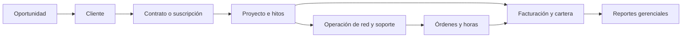
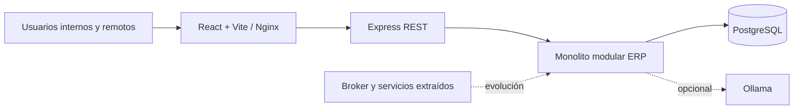
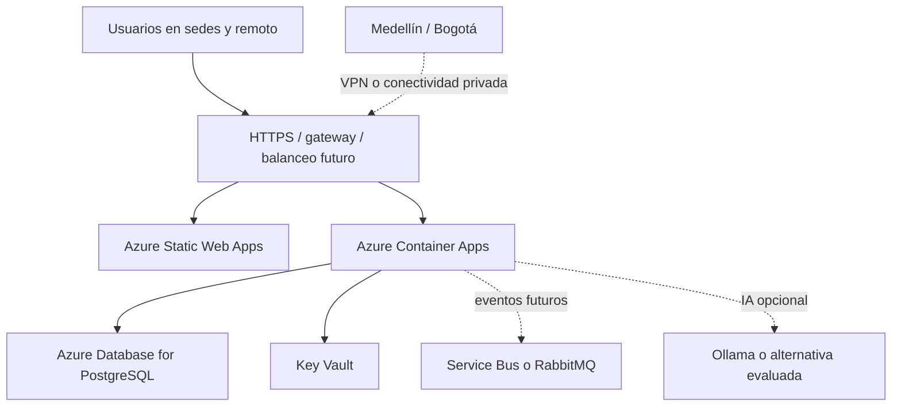

# Arquitectura empresarial bajo TOGAF ADM

## 1. Introducción y alcance

Este documento organiza la arquitectura empresarial de Nexus Safe-Cloud mediante las fases relevantes de TOGAF ADM. Su alcance corresponde a las evidencias 1 y 2 del Requisito Técnico 3: alineación entre estrategia, capacidades empresariales y arquitecturas de negocio, datos, aplicaciones y tecnología.

El análisis no desarrolla el impacto financiero detallado del punto 3 ni sustituye el dossier SAD del Requisito Técnico 5. Las vistas 4+1, ADRs y contratos técnicos deben mantenerse en el dossier SAD; aquí se utilizan únicamente como referencias de trazabilidad.

## 2. Alineación con TOGAF ADM

### Fase preliminar

#### Alcance

El alcance cubre la centralización del ERP para las operaciones de Medellín, Bogotá y trabajo remoto, su ejecución Docker local y la evolución futura hacia nube. No implica que Azure, RabbitMQ, ZTNA, SSO/MFA ni microservicios independientes estén implementados.

#### Principios

1. Mantener una fuente empresarial confiable para las transacciones del ERP.
2. Separar capacidades empresariales de módulos tecnológicos.
3. Evolucionar desde un monolito modular antes de extraer servicios independientes.
4. Conservar trazabilidad del origen de datos importados, sintéticos y manuales.
5. Aplicar mínimo privilegio, auditoría y protección de secretos.
6. No presentar una propuesta futura como capacidad implementada.
7. Registrar decisiones que alteren límites, datos, comunicación o tecnología.

#### Gobierno

El gobierno requerido incluye responsables de negocio, dueños de datos, revisión de arquitectura, control de cambios, criterios de aceptación y trazabilidad entre requisitos, código y evidencias. El repositorio tiene ADRs, pruebas y documentación, pero aún no demuestra un comité formal ni un RACI operativo.

### Fase A — Visión de arquitectura

La visión es consolidar en un ERP la información comercial, contractual, operativa, financiera y técnica, reduciendo duplicidad y reprocesos y mejorando la toma de decisiones entre sedes.

Los interesados principales son:

| Stakeholder | Necesidad arquitectónica |
|---|---|
| Gerencia general | Indicadores, rentabilidad, cartera y visión consolidada |
| Dirección comercial | CRM, oportunidades y disponibilidad antes de comprometer trabajo |
| PMO / líderes de proyecto | Proyectos, hitos, tareas, riesgos y capacidad |
| Analista financiero | Facturación, cuentas por cobrar y auditoría |
| Administrador TI | Activos, redes, identidades, políticas y continuidad |
| Consultores y técnicos | Tareas y horas propias, sin acceso indebido a finanzas |
| Clientes externos | Consulta futura y restringida de sus proyectos |
| Administrador del sistema | Usuarios, roles y configuración, separado del negocio |

Los atributos de calidad del Corte 1 —disponibilidad, seguridad, integridad, rendimiento, escalabilidad, interoperabilidad, trazabilidad, usabilidad y mantenibilidad— son objetivos arquitectónicos. No deben presentarse como resultados verificados.

### Fase B — Arquitectura de negocio

#### Mapa de capacidades

| Dominio | Capacidad | Propósito | Stakeholders | Soporte actual | Valor esperado |
|---|---|---|---|---|---|
| Comercial | Gestión de clientes y oportunidades | Conocer relación, pipeline y próximos cierres | Comercial, gerencia | Clientes y CRM implementados/parciales | Menos duplicidad y mejor seguimiento |
| Comercial | Gestión de contratos y suscripciones | Formalizar alcance y recurrencia | Comercial, PMO, finanzas | Contratos y suscripciones en MVP | Relacionar servicio, alcance e ingreso |
| Ejecución | Gestión de proyectos | Coordinar alcance, avance, hitos y responsables | PMO, técnicos, gerencia | Proyectos e hitos parciales | Control operativo de compromisos |
| Ejecución | Gestión de recursos y capacidad | Comparar demanda con disponibilidad y habilidades | PMO, comercial, técnicos | Horas y responsables; sin calendario completo | Evitar sobreasignación |
| Finanzas | Facturación y cuentas por cobrar | Emitir, consultar y seguir facturas | Finanzas, gerencia | Facturas, aging y auditoría parcial | Menos reprocesos y mejor seguimiento |
| Finanzas | Gestión financiera y reportes | Registrar gastos y contabilidad gerencial | Finanzas, gerencia | Compras, gastos y contabilidad gerencial | Mejor control administrativo |
| Tecnología | Gestión de infraestructura y conectividad | Conocer activos, enlaces, VLAN y hallazgos | TI, técnicos, PMO | Inventario histórico y topología | Mejor diagnóstico y trazabilidad técnica |
| Seguridad | Identidad, acceso y auditoría | Restringir y atribuir operaciones | Administrador, TI, todos los usuarios | Roles, sesiones, CORS, rate limit y eventos | Menor exposición y mayor control |
| Gobierno | Calidad y gobierno de datos | Definir origen, integridad y uso de información | Gerencia, TI, dueños de datos | Restricciones y `data_origin`; gobierno formal pendiente | Fuente confiable y decisiones trazables |

Una capacidad representa una aptitud empresarial estable. Una pantalla, tabla o endpoint solo es un medio que puede habilitarla parcialmente; no prueba por sí solo que la capacidad esté completa.

#### Procesos principales

### Fase C — Arquitectura de sistemas de información

#### Arquitectura de datos

La implementación actual utiliza PostgreSQL como persistencia transaccional compartida. Los scripts 01–18 crean usuarios, clientes, proyectos, redes, contratos, hallazgos, trabajo, facturación, IoT, CRM, suscripciones, compras, contabilidad y recursos humanos. Los datos se producen mediante frontend/API, importadores Excel y semillas sintéticas.

| Dominio de datos | Información principal | Productores y consumidores | Gobierno actual / objetivo |
|---|---|---|---|
| Identidad | Usuarios, roles, sesiones y eventos | Auth, Users, todos los módulos | RBAC y auditoría actuales; MFA/SSO objetivo |
| Cliente y proyecto | Clientes, proyectos, hitos y responsables | Clients, Projects, Dashboard, Contracts | Relaciones y restricciones; fuente única objetivo |
| Contrato | Contratos, alcance y suscripciones | Service Contracts, Billing, Network | Alcance técnico relacionado; reglas de negocio deben ampliarse |
| Red | Sitios, activos, interfaces, IP, MAC, enlaces, VLAN | Network, Findings, Reports | Procedencia, índices y restricciones; calidad continua pendiente |
| Operación | Hallazgos, órdenes y horas | Findings, Work, Projects, Billing | Registro de horas disponible; capacidad completa pendiente |
| Finanzas | Facturas, cartera, gastos, cuentas y asientos | Billing, Procurement, Accounting | Modelo gerencial; no facturación DIAN ni datos financieros reales |
| Personas | Empleados y técnicos | HR, Work, Projects | Directorio disponible; habilidades y disponibilidad pendiente |
| IoT | Capturas y métricas agregadas | IoT, AI | No se almacena payload bruto según ADR-0002 |
| Auditoría | Cambios y eventos críticos | Auth y módulos | Parcialmente implementada; cobertura integral a validar |

La fuente única actual se refiere a la base PostgreSQL del ERP, no a una replicación multi-sede. La deduplicación de importaciones utiliza identificadores, hashes y reglas de normalización, pero el gobierno empresarial debe definir propietarios, retención, clasificación, backup y calidad.

La arquitectura objetivo puede incorporar eventos para integración asíncrona, pero RabbitMQ/Kafka/Azure Service Bus no están implementados en el repositorio. Por tanto, los eventos deben documentarse como transición propuesta.

#### Arquitectura de aplicaciones

| Subsistema o módulo | Responsabilidad | Capacidades | Datos principales | Integraciones | Estado |
|---|---|---|---|---|---|
| Auth / Users | Login, sesiones, roles y permisos | Identidad y seguridad | Users, sessions, auth events | Frontend, cookies | Implementado/parcial |
| Clients / CRM | Clientes y oportunidades | Gestión comercial | Clients, opportunities | API y dashboard | Implementado/parcial |
| Projects | Proyectos, avance y responsables | Gestión de proyectos | Projects, milestones | Clients, Work, Billing | Parcial |
| Service Contracts | Contratos y alcance | Gestión contractual | Contracts, scope items | Clients, Network, Billing | Implementado en MVP |
| Network | Inventario y topología | Infraestructura y conectividad | Assets, links, VLAN, sites | Importadores, Findings | Implementado para muestra |
| Findings / Work | Riesgos, órdenes y horas | Operación y recursos | Findings, work orders, time entries | Network, Projects, Billing | Implementado/parcial |
| Billing | Facturas, hitos y aging | Facturación y cartera | Invoices, receivables view | Projects, Contracts | Parcial |
| Procurement / Accounting | Gastos, compras y asientos | Control financiero | Suppliers, expenses, journal entries | Reports | Modelo MVP |
| HR | Directorio laboral | Personas y organización | HR employees | Work | Implementado como directorio |
| IoT / AI | Métricas históricas y explicación IA | Analítica técnica | Captures and aggregates | Ollama opcional | Parcial |

La comunicación actual es síncrona mediante REST y llamadas internas al mismo proceso. API Gateway, BFF, GraphQL, CQRS, circuit breaker, retry, bulkhead, webhooks y broker son patrones de la arquitectura objetivo, no capacidades demostradas por el código actual.

La evolución recomendada es incremental: estabilizar el monolito modular, identificar límites con métricas reales, extraer primero un flujo con alta autonomía y usar Strangler Fig. No se recomienda dividir todo el ERP en microservicios desde el inicio.

### Fase D — Arquitectura tecnológica

#### Situación actual / transición local

| Componente | Tecnología | Responsabilidad | Estado | Justificación empresarial |
|---|---|---|---|---|
| Frontend | React, TypeScript, Vite | Interfaz de módulos y roles | Implementado | Acceso unificado a procesos |
| Servidor web | Nginx en Docker | Servir SPA | Implementado localmente | Despliegue reproducible |
| Backend | Node.js 22, Express, TypeScript | API y lógica modular | Implementado | Centraliza reglas y acceso |
| Persistencia | PostgreSQL | Datos transaccionales | Implementado | Integridad y fuente central |
| Contenedores | Docker Compose | Entorno reproducible | Implementado localmente | Reduce diferencias entre equipos |
| IA auxiliar | Ollama `qwen2.5:3b` | Explicaciones técnicas opcionales | Implementado como integración | Apoya diagnóstico sin ser núcleo transaccional |
| API | REST/OpenAPI parcial | Interoperabilidad frontend/backend | Implementado/parcial | Contratos explícitos y evolución |
| Seguridad | Cookies, roles, CORS, Helmet, rate limit | Protección y autorización | Parcial | Base para mínimo privilegio |
| Mensajería | RabbitMQ/Kafka/Service Bus | Eventos y desacoplamiento | No implementado | Requisito futuro de sistemas distribuidos |

#### Arquitectura tecnológica objetivo

La arquitectura objetivo propuesta requiere validar red, identidad, secretos, backup, disponibilidad, observabilidad, costos y criterios de escalamiento. Azure no está desplegado en el repositorio. PostgreSQL administrado, balanceo, zonas de disponibilidad, failover, SIEM/NOC y ZTNA son elementos objetivos del Corte 1, no implementaciones actuales.

### Fases E y F — Oportunidades, soluciones y migración

| Fase | Situación actual | Situación objetivo | Brecha | Iniciativa | Prioridad | Dependencias |
|---|---|---|---|---|---|---|
| Estabilización | Monolito modular y Docker local | AS-IS reproducible y medible | Falta línea base operativa completa | Pruebas, contratos API, observabilidad local | Alta | Equipo técnico |
| Gobierno de datos | SQL, restricciones y procedencia parcial | Dueños, calidad y retención definidos | No hay gobierno formal completo | Catálogo y reglas de calidad | Alta | Responsables de negocio |
| Capacidad | Horas y responsables | Disponibilidad, habilidades y no sobreasignación | No hay calendario/capacidad | Modelo y proceso de planificación | Alta | PMO y HR |
| Eventos | Comunicación REST e interna | Eventos para flujos seleccionados | No hay broker ni contratos | Elegir broker y demostrar un evento | Media | Decisión RT1 |
| Cloud | Compose local | Azure administrado | Sin IaC, red ni costos validados | Diseñar y luego desplegar Azure | Media | FinOps y seguridad |
| Resiliencia | Healthchecks locales | SLA, RTO, RPO y failover | Sin pruebas cloud | Backups, monitoreo y recuperación | Media | Azure y presupuesto |

La migración debe seguir Strangler Fig: conservar el núcleo modular, extraer capacidades solo cuando exista justificación de carga, autonomía, seguridad o ciclo de vida, y mantener contratos de integración verificables.

## 3. Relación con objetivos empresariales

- **Visibilidad:** clientes, proyectos, contratos, operaciones, facturas y reportes se relacionan en una base central y mediante API.
- **Menos reprocesos:** restricciones, importadores, procedencia y flujos relacionados reducen duplicidad, aunque requieren gobierno de datos.
- **Control de proyectos:** hitos, responsables, órdenes y horas dan una base operativa; tareas completas, riesgos y rentabilidad todavía son brechas.
- **Seguimiento de cartera:** facturas y aging permiten organizar saldos; no demuestran cartera real ni integración fiscal.
- **Recursos:** órdenes, responsables y horas aportan trazabilidad; disponibilidad, habilidades y doble asignación requieren desarrollo adicional.
- **Seguridad:** roles, sesiones, autorización, CORS, rate limit y auditoría son una base; MFA, SSO y ZTNA son objetivos futuros.
- **Continuidad y escala:** Docker mejora reproducibilidad local; disponibilidad ≥99.5%, RTO/RPO, failover y crecimiento del 100% requieren plataforma, pruebas y monitoreo cloud.

Estas relaciones describen mecanismos y resultados esperados. El análisis financiero detallado, costos, ahorros y rentabilidad cuantificada corresponde al tercer punto del requisito y queda fuera de este documento.

## 4. Conclusiones

La arquitectura empresarial de Nexus debe defenderse como una evolución controlada: un ERP modular centraliza información y procesos hoy; Docker ofrece una base reproducible; y Azure, mensajería y servicios distribuidos constituyen una arquitectura objetivo condicionada a decisiones, costos y validación.

TOGAF aporta la estructura para conectar problemas, capacidades, datos, aplicaciones, tecnología, migración y gobierno. La evidencia actual sustenta el mapa de capacidades y la trazabilidad operativa, pero no permite afirmar que la rentabilidad, capacidad técnica completa, alta disponibilidad, seguridad avanzada o arquitectura de microservicios estén resueltas.

La propuesta más coherente para el Corte 3 es mostrar qué está implementado, qué funciona parcialmente y qué se propone como transición, evitando presentar la arquitectura objetivo como si ya fuera el sistema operativo de Nexus.
