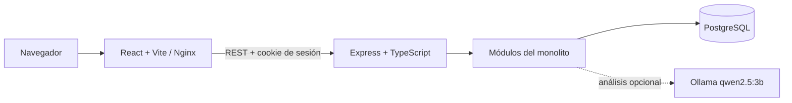

# Diagnóstico TOGAF ADM — Requisito Técnico 3

**Proyecto:** Nexus Safe-Cloud ERP
**Corte:** 3 — Shark Tank
**Tipo de documento:** auditoría y diagnóstico preparatorio
**Estado:** no constituye todavía el dossier TOGAF definitivo
**Fecha de revisión:** 7 de noviembre de 2026

## 1. Resumen ejecutivo

El Requisito Técnico 3 exige demostrar cómo la arquitectura propuesta responde a objetivos estratégicos de Nexus Safe-Cloud bajo TOGAF ADM. La evidencia esperada se concentra en tres resultados: una matriz de trazabilidad entre dolores de negocio y subsistemas técnicos; la definición de capacidades y arquitecturas de negocio, datos, aplicaciones y tecnología; y una explicación verificable del impacto esperado sobre rentabilidad y control financiero.

La evidencia disponible permite sostener que Nexus tiene un ERP funcional para un MVP académico, con módulos de clientes, proyectos, contratos, operación de red, hallazgos, órdenes de trabajo, facturación, CRM, suscripciones, compras, contabilidad gerencial, recursos humanos e IoT histórico. La arquitectura real es un **monolito modular**: un backend Express/TypeScript y una aplicación React/Vite comparten una base PostgreSQL. La contenerización Docker local ya está preparada, pero Azure, RabbitMQ, microservicios independientes, alta disponibilidad y mensajería asíncrona continúan siendo propuestas o trabajo pendiente.

El diagnóstico principal es que la arquitectura tecnológica ya ofrece mecanismos de centralización, trazabilidad, control de acceso y relación entre operación y facturación, pero no demuestra todavía rentabilidad completa por proyecto, planificación de capacidad, cartera real multi-sede, facturación electrónica legal ni continuidad cloud. Por eso el entregable debe presentar beneficios como mecanismos e indicadores de seguimiento, no como resultados financieros ya obtenidos.

## 2. Fuentes analizadas

### Repositorio

- `backend/`: Express, TypeScript, módulos, controladores, servicios, repositorios, autenticación, pruebas y scripts CLI.
- `frontend/`: React, Vite, React Router, servicios REST y pantallas funcionales.
- `database/scripts/`: creación de base, esquema estructural 01–18 y datos sintéticos 90.
- `docker-compose.yml`, Dockerfiles, entrypoint e inicialización Docker.
- `.env.example`, README y configuración de puertos.
- `docs/api/openapi.yaml` y `docs/api/README.md`.
- `docs/architecture/`: ADR-0001, ADR-0002, ADR-0003, dominio de red y análisis de datos.
- `docs/mvp/matriz-trazabilidad.md`, `linea-base.md`, `supuestos.md`, `guion-demo.md` y `triaje-incidencias.md`.

### Excel

#### `data/Data_para_Proveedor_ERP.xlsx`

Hojas revisadas:

- `Dispositivos`: resumen de 74 enlaces y 10 equipos de infraestructura.
- `01 Inventario`: 76 activos, tipo, modelo, categoría, rol inferido, criticidad, seriales, IP, MAC y configuración.
- `02 CORE`: controles y capacidades observables como NetFlow, Syslog, SNMP, NTP, SSH, AAA, HSRP, DHCP, ACL y NAT.
- `03 Enlaces`: 74 enlaces, extremos, puertos, tipo, funcionalidad y criticidad sugerida.
- `04 Interfaces Config`: 147 registros de interfaces y VLAN.
- `05 VLAN DHCP`: VLAN, redes, máscaras, gateways y DNS.
- `06 Monitoreo`: capacidades o presencia de indicadores de monitoreo.
- `07 Posible Monitoreo`: tecnologías candidatas, puertos y datos que deberían confirmarse con un proveedor.
- `08 IPS MAC GATEWAY`: relaciones de direccionamiento, MAC, gateway, DNS y DHCP.

Este archivo aporta evidencia técnica de inventario y topología. No demuestra clientes pagadores, ingresos, gastos, facturas reales, cartera, salarios ni rentabilidad.

#### `data/Equipos_Monitoreo_Red_5196.xlsx`

La hoja `Equipos y Señales` contiene 21 tipos de equipo, señales observables, protocolos, puertos, plataformas sugeridas y prioridad. La hoja `Notas` aclara que son capacidades o posibilidades de monitoreo, no una prueba de colectores operativos ni telemetría activa.

#### `data/captura_tcp-2_Grupo_Eventos_Temporales.xlsx`

Hojas revisadas:

- `Resumen`: 148 paquetes y 57 paquetes con payload.
- `Paquetes`: tiempos, bytes de frame, IP, puertos, protocolo, flags y bytes de payload.
- `Payloads`: clasificación y tamaño, además de columnas ASCII y hexadecimal.
- `Conversaciones`: extremos, paquetes, bytes y duración.

Es una captura histórica de laboratorio. Puede sustentar analítica técnica agregada, no disponibilidad en vivo, operación productiva, seguridad confirmada ni desempeño empresarial.

#### `data/Datos_PacketTracer.xlsx`

Contiene las hojas `Inventario Dispositivos` e `IOT`, pero su estructura visible presenta encabezados genéricos y un volumen diferente al archivo técnico principal. El repositorio y ADR-0001 lo descartan por contradicciones con `Data_para_Proveedor_ERP.xlsx`. No debe usarse como fuente principal de la matriz empresarial.

### PDFs

Se identificaron `Equipo3_Corte1_Informe.pdf` y `Equipo3_Corte1_Slides.pdf`. En este entorno no fue posible extraer su contenido porque no están disponibles Poppler (`pdfinfo`/`pdftotext`) ni una biblioteca PDF instalada. Por tanto, no se atribuyen hallazgos específicos a páginas de esos PDF. Los documentos Markdown existentes se utilizaron como evidencia disponible, y los contenidos de los PDF deben verificarse manualmente antes de cerrar la versión académica definitiva.

## 3. Contexto empresarial de Nexus

El pliego define a Nexus como una empresa con operación distribuida entre Medellín, Bogotá y colaboradores remotos. Los dolores explícitos son dispersión operativa, baja visibilidad de rentabilidad de proyectos, inconsistencias entre sedes, errores de facturación, cartera vencida, dificultad para controlar capacidad técnica y riesgos de accesos no controlados.

El repositorio modela una empresa de servicios gestionados/SaaS mediante clientes, oportunidades, contratos, suscripciones, proyectos de implementación, soporte, activos de red, órdenes de trabajo, horas, facturas, gastos y contabilidad gerencial. ADR-0001 y ADR-0003 advierten que los datos de demo son sintéticos y que no prueban operaciones comerciales reales.

No se encontró evidencia suficiente para afirmar:

- ingresos reales de Nexus;
- cartera real vencida;
- rentabilidad histórica por proyecto;
- nómina, salarios o costos laborales reales;
- capacidad técnica real por sede;
- contratos comerciales vigentes;
- integración con DIAN;
- telemetría de red en producción.

## 4. Diagnóstico de la arquitectura actual

### Arquitectura real

El backend tiene módulos internos, no servicios desplegables independientes. La comunicación entre módulos ocurre dentro del mismo proceso y mediante PostgreSQL; la interfaz usa REST. No se encontraron RabbitMQ, AMQP, colas, consumidores, contratos de eventos ni consistencia eventual implementada.

### Componentes implementados

| Componente | Estado | Evidencia |
|---|---|---|
| Backend Express/TypeScript | Implementado | `backend/src/server.ts`, `app.ts`, `package.json` |
| Frontend React/Vite | Implementado | `frontend/src/main.tsx`, `vite.config.ts` |
| PostgreSQL | Implementado | `backend/src/config/database.ts`, scripts 01–18 |
| REST/OpenAPI | Parcial | `docs/api/openapi.yaml`; no cubre todos los endpoints |
| Autenticación y roles | Implementado/parcial | `shared/auth.ts`, rutas y pruebas |
| Auditoría | Implementado en varios flujos | `shared/audit.ts`, `audit_log` |
| Ollama | Implementado como integración opcional | `backend/src/modules/ai/` |
| Docker local | Implementado durante esta etapa | Dockerfiles, Compose y healthchecks |
| RabbitMQ | No implementado | No hay dependencias, configuración ni consumidores |
| Azure | No implementado | No hay despliegue ni IaC cloud |
| Microservicios independientes | No implementado | El sistema es monolito modular |

### Fortalezas

- Separación modular razonable dentro del backend.
- Relaciones y restricciones PostgreSQL para entidades centrales.
- Roles, cookies de sesión, rate limit, CORS y auditoría.
- Procedencia `IMPORTED`, `SYNTHETIC` y `MANUAL`.
- Datos de red reconciliados: 76 activos, 74 enlaces, 147 interfaces y 17 VLAN según la carga ejecutada.
- Datos sintéticos repetibles para demostración.
- Docker local con persistencia y healthchecks.

### Limitaciones

- No hay rentabilidad completa por proyecto: existen presupuesto, horas, ingresos y gastos en partes separadas, pero falta un cálculo integral validado.
- No existe planificación formal de capacidad, habilidades, calendario ni doble asignación.
- La facturación es gerencial/simulada, no facturación electrónica legal.
- El inventario es estático; no hay monitoreo en vivo ni failover.
- No existe mensajería asíncrona ni desacoplamiento entre módulos.
- PostgreSQL no tiene migraciones aplicadas registradas automáticamente.
- Alta disponibilidad, balanceo y observabilidad cloud no están implementados.

## 5. Análisis de TOGAF ADM

| Fase ADM | Información disponible | Información faltante | Evidencia requerida | Relación con requisito 3 |
|---|---|---|---|---|
| Preliminary | ADRs, restricciones del pliego, módulos y principios de seguridad | Gobierno formal, responsables y criterios de aprobación | Principios, alcance, roles de gobierno y catálogo de decisiones | Base metodológica |
| A — Vision | Dolores del pliego, sedes, objetivo de centralización y MVP | Metas cuantificadas y patrocinador formal | Declaración de visión, interesados, alcance y beneficios | Conecta estrategia con solución |
| B — Business | Capacidades del ERP y procesos de servicio gestionado | Procesos actuales reales, RACI y políticas entre sedes | Mapa de capacidades, procesos, actores y dolores | Punto 1 y punto 2 |
| C — Data | Tablas SQL, Excel, procedencia y relaciones | Dueños de datos, calidad, retención, clasificación formal | Modelo conceptual, flujos, CRUD y reglas de calidad | Punto 2 |
| C — Applications | React, API Express, módulos y Ollama | Límites futuros de servicios y contratos completos | Vista de aplicaciones, dependencias y APIs | Punto 1 y punto 2 |
| D — Technology | Docker local, Node 22, PostgreSQL, Nginx y Ollama | Azure target, red, SLA, escalado y costos | Topología AS-IS/TO-BE, seguridad y disponibilidad | Punto 2; coherencia con requisitos 1 y 2 |
| E — Opportunities | Contenerización y ruta cloud propuesta | Priorización, costos y decisiones de broker | Opciones, trade-offs y arquitectura transición | Punto 3 y roadmap |
| F — Migration | Docker validado localmente y brechas conocidas | Fechas, responsables, presupuesto y dependencias | Roadmap por fases con criterios de aceptación | Evidencia de viabilidad |
| G — Governance | Pruebas, ADRs y healthchecks | Comité, controles de cambio y aceptación formal | Plan de gobernanza de implementación | Calidad y trazabilidad |
| H — Change | ADRs y documentación evolutiva | Proceso de revisión de cambios y triggers | Registro de cambios, revisiones y deuda | Sostenibilidad arquitectónica |
| Requirements Management | Matriz MVP, pruebas y rutas de código | Trazabilidad completa requisito–dato–módulo–indicador | Matriz consolidada y control de versiones | Une los tres puntos |

## 6. Desarrollo propuesto del punto 1: trazabilidad estratégica

La matriz definitiva debe agregar evidencia, no solo nombres de módulos. Se recomiendan estas columnas: ID, dolor, fuente, evidencia, objetivo estratégico, capacidad, proceso, datos, módulo, componente técnico, estado, indicador, beneficio esperado, riesgo y dependencia.

### Matriz preliminar sustentada

| ID | Dolor respaldado | Evidencia | Objetivo estratégico | Capacidad/proceso | Módulo y componente | Estado | Indicador futuro |
|---|---|---|---|---|---|---|---|
| T01 | Dispersión operativa entre sedes | Pliego; modelo de sedes y clientes en SQL | Centralizar información operacional | Gestión de clientes, proyectos y activos | Clients, Projects, Network + PostgreSQL central | Parcial | Registros duplicados o inconsistentes por entidad |
| T02 | Baja visibilidad de rentabilidad | Pliego; `matriz-trazabilidad.md` marca RF01 parcial | Controlar margen por proyecto | Proyectos, horas, facturación y gastos | Projects, Work, Billing, Procurement, Accounting | Brecha | Ingresos − costos directos por proyecto |
| T03 | Errores de facturación | Pliego; `billing`, hitos, auditoría y ADR-0003 | Facturar con trazabilidad | Contratos, hitos, facturas y cartera | Billing + PostgreSQL + audit_log | Parcial | Facturas con hito, contrato y estado auditables |
| T04 | Cartera vencida | Pliego; vista `v_receivables_aging` y pantalla de cartera | Mejorar recaudo | Cuentas por cobrar | Billing + vista aging | Parcial | Saldo vencido por rango y cliente |
| T05 | Capacidad técnica difícil de controlar | Pliego; RF08 y HU-01/HU-06 parciales | Planificar asignación técnica | Órdenes, horas, responsables y HR | Work, HR, Projects | Brecha parcial | Horas disponibles vs. comprometidas |
| T06 | Accesos no controlados | Pliego; autenticación, roles, sesiones y eventos | Reducir exposición de información | Identidad, autorización y auditoría | Auth, Users, CORS, rate limit, audit_log | Parcial | Accesos denegados y eventos auditados |
| T07 | Información técnica inconsistente | Excel y ADR-0001; importación con procedencia e incidencias | Mejorar calidad de inventario | Inventario, topología y monitoreo | Network + importadores + data_origin | Implementado para muestra | Activos reconciliados y errores por severidad |

Las relaciones T02, T04 y T05 deben marcarse como impacto esperado hasta disponer de datos reales y fórmulas validadas.

## 7. Desarrollo propuesto del punto 2

### 7.1 Arquitectura de negocio

#### Capacidades empresariales

- Gestión comercial y clientes.
- Gestión de oportunidades y suscripciones.
- Gestión contractual.
- Gestión de proyectos e hitos.
- Operación de redes y activos.
- Gestión de hallazgos y órdenes de trabajo.
- Registro de horas y recursos.
- Facturación y cartera.
- Compras y gastos.
- Contabilidad gerencial.
- Gestión del equipo de trabajo.
- Analítica técnica e IoT histórico.
- Gobierno de acceso y auditoría.

Una capacidad expresa lo que la empresa debe poder hacer; un módulo expresa cómo el software apoya esa capacidad. Por ejemplo, “gestión de capacidad técnica” es una capacidad, mientras `work` y `hr` son módulos que actualmente solo la soportan parcialmente.

#### Procesos a representar

1. Oportunidad → cliente → contrato/suscripción.
2. Contrato → proyecto/hitos → operación.
3. Activo/hallazgo → orden → horas → posible facturación.
4. Hito cerrado → factura → pago → cartera.
5. Compra/gasto → contabilidad gerencial.
6. Usuario → rol → autorización → auditoría.

### 7.2 Arquitectura de datos

Entidades principales existentes:

- `users`, roles, sesiones y eventos de autenticación.
- `clients`, `projects`, `project_milestones`.
- `service_contracts`, `contract_scope_items`.
- `sites`, `network_assets`, interfaces, IP, MAC, enlaces, VLAN y pools.
- `findings`, `work_orders`, `time_entries`.
- `invoices` y vista de cartera.
- CRM, planes, suscripciones, proveedores, órdenes de compra y gastos.
- Cuentas, asientos y líneas contables.
- Empleados y capturas IoT agregadas.

Fuentes:

- Entrada manual desde frontend.
- Importaciones Excel.
- Datos sintéticos de demo.
- Capturas IoT agregadas.

Problemas y decisiones:

- El repositorio centraliza datos en PostgreSQL, pero no demuestra replicación entre sedes.
- `data_origin` ayuda a distinguir origen, pero no sustituye gobierno y calidad de datos.
- La captura Excel contiene payload ASCII/hex, pero ADR-0002 establece que no se almacena contenido bruto.
- Deben definirse propietarios, clasificación, retención, backup y reglas de calidad para una arquitectura empresarial completa.

### 7.3 Arquitectura de aplicaciones

La aplicación actual debe representarse como un bloque de monolito modular con módulos internos, no como microservicios. La vista debe mostrar:

- navegador y frontend React;
- API Express y middleware de seguridad;
- módulos y servicios internos;
- PostgreSQL como persistencia compartida;
- Ollama como integración externa opcional;
- scripts de importación y seed como procesos operativos, no como módulos de negocio permanentes.

La arquitectura objetivo puede mostrar una evolución futura hacia servicios distribuidos, pero debe usar color, etiquetas o notas para distinguir “propuesto” de “implementado”. RabbitMQ debe aparecer únicamente como componente futuro hasta su validación.

### 7.4 Arquitectura tecnológica

#### AS-IS/MVP

- Node.js 22, Express, TypeScript.
- React, Vite, TypeScript y Nginx en Docker.
- PostgreSQL 16 en Docker local con volumen.
- Ollama `qwen2.5:3b` en servicio Docker auxiliar.
- REST, cookies, CORS, roles, rate limit y healthchecks.
- Sin Azure, broker, balanceador cloud ni alta disponibilidad.

#### TO-BE propuesto

- Frontend en Azure Static Web Apps.
- Backend contenerizado en Azure Container Apps.
- PostgreSQL en Azure Database for PostgreSQL Flexible Server.
- Secretos en Key Vault y observabilidad administrada.
- Service Bus o RabbitMQ solo después de decisión y validación.
- Escalamiento, failover, HTTPS, red privada y monitoreo.

No debe presentarse el TO-BE como despliegue ejecutado.

## 8. Desarrollo propuesto del punto 3: impacto financiero y operativo

### Mecanismos verificables

| Mecanismo | Relación con el negocio | Datos actuales | Limitación |
|---|---|---|---|
| Hitos y facturas | Vincula avance de proyecto con facturación | Sí, en demo | No prueba recaudo real |
| Vista aging | Ordena cartera por antigüedad | Sí, si existen facturas | Datos sintéticos o de demo |
| Horas por orden | Relaciona esfuerzo con trabajo | Sí | Falta tarifa/costo laboral real |
| Compras y gastos | Registra costos operativos | Modelo y demo | No hay costos reales validados |
| Contabilidad gerencial | Consolida asientos y reportes | Modelo y demo | No sustituye contabilidad legal |
| Contrato–activo–hallazgo | Relaciona alcance técnico con operación | Sí | Inventario no es telemetría viva |

### Indicadores propuestos

| Indicador | Fórmula | Datos/módulos | Frecuencia | ¿Calculable hoy? |
|---|---|---|---|---|
| Margen bruto por proyecto | ingresos reconocidos − costos directos | Facturas, horas, gastos, Projects, Billing, Work, Accounting | Mensual | Parcial; faltan costos/tarifas confiables |
| Margen porcentual | margen bruto / ingresos × 100 | Mismos datos | Mensual | No con rigor sobre demo |
| Desviación de horas | horas registradas − horas estimadas | `time_entries`, proyectos y órdenes | Semanal | Sí en demo, no capacidad real |
| Cobertura de facturación de hitos | hitos facturables facturados / hitos cerrados × 100 | Milestones, invoices | Semanal | Sí cuando existan datos completos |
| Días de cartera | fecha actual − fecha de vencimiento | Invoices/aging | Semanal | Sí para facturas existentes |
| Ratio de cartera vencida | saldo vencido / saldo total × 100 | `v_receivables_aging` | Mensual | Sí en demo |
| Gasto por proyecto | gastos imputados / proyecto | Procurement, expenses, Projects | Mensual | Requiere imputación explícita |
| Utilización técnica | horas asignadas / horas disponibles × 100 | Work, HR, calendario | Semanal | No; no existe disponibilidad |
| Calidad de inventario | registros aceptados / registros leídos × 100 | Importadores y lotes | Por carga | Sí para archivos importados |
| Accesos no autorizados | eventos fallidos o denegados por periodo | Auth events/audit | Diario | Parcial; falta contexto completo de sede/dispositivo |

No se pueden afirmar porcentajes de mejora, ahorros ni incremento de rentabilidad sin una línea base financiera real.

La relación con FinOps debe separar dos conceptos: la rentabilidad operativa del negocio, medida con proyectos, horas, facturas y gastos; y el costo de la plataforma cloud, medido con consumo de Container Apps, PostgreSQL, almacenamiento, observabilidad, mensajería y eventualmente IA.

## 9. Brechas identificadas

### Información empresarial faltante

- Procesos actuales por sede y responsables.
- RACI y gobierno de datos.
- Clientes, contratos, tarifas y cartera reales.
- Costos laborales y tarifas por rol.
- Capacidad disponible y calendario técnico.
- Objetivos estratégicos cuantificados y línea base.

### Funcionalidades no implementadas o parciales

- Rentabilidad integral por proyecto.
- Planificación de capacidad y habilidades.
- Facturación electrónica DIAN.
- Telemetría y disponibilidad en vivo.
- SSO, MFA y ZTNA.
- Mensajería asíncrona y microservicios independientes.
- Alta disponibilidad y failover cloud.

### Datos insuficientes

- Los Excel técnicos no contienen información financiera.
- La captura IoT es histórica y puntual.
- Los datos de demo son sintéticos.
- `Datos_PacketTracer.xlsx` no coincide con la fuente principal del dominio de red.

### Inconsistencias o decisiones pendientes

- La arquitectura objetivo debe evitar llamar microservicios a los módulos actuales.
- Debe decidirse broker y patrón de integración antes de afirmar consistencia eventual.
- Debe definirse si Ollama es solo local, un servicio administrado alternativo o una capacidad separada en cloud.
- Debe definirse la versión objetivo de PostgreSQL administrado y la política de backup.
- La matriz definitiva debe separar indicadores calculables de indicadores aspiracionales.

## 10. Estructura recomendada de entregables definitivos

| Archivo recomendado | Propósito | Contenido | Dependencias |
|---|---|---|---|
| `01_vision_y_alcance.md` | Fases Preliminary/A | Interesados, objetivos, alcance, principios | Pliego y diagnóstico |
| `02_mapa_capacidades.md` | Fase B | Capacidades, actores, procesos y brechas | Entrevistas y módulos |
| `03_matriz_trazabilidad.md` | Requirements Management | Dolor–objetivo–capacidad–módulo–indicador | Datos reales y SAD |
| `04_arquitectura_datos.md` | Fase C | Entidades, flujos, calidad, propietarios | SQL y gobierno de datos |
| `05_arquitectura_aplicaciones.md` | Fase C | Monolito actual, APIs, evolución propuesta | OpenAPI y ADRs |
| `06_arquitectura_tecnologica.md` | Fase D | Docker AS-IS, Azure TO-BE, seguridad y disponibilidad | Requisitos 1 y 2 |
| `07_impacto_financiero.md` | Evidencia punto 3 | Indicadores, fórmulas, línea base y límites | Datos financieros reales |
| `08_roadmap_y_gobierno.md` | Fases E–H | Migración, aceptación, riesgos y cambios | FinOps, SAD y decisiones |
| `09_dossier_SAD.pdf` | Requisito 5 | Vistas 4+1, atributos de calidad, ADRs y contratos | Todos los anteriores |

No conviene duplicar los ADRs ni reemplazar la matriz MVP; deben enlazarse y conservar sus alcances.

## 11. Plan de trabajo

### Puede construirse inmediatamente

1. Congelar el AS-IS verificable del monolito modular.
2. Aprobar el mapa de capacidades y la matriz preliminar.
3. Elaborar vistas de datos y aplicaciones basadas en SQL y código.
4. Documentar Docker local como arquitectura de transición.
5. Formalizar indicadores y marcar cuáles requieren datos nuevos.
6. Crear el registro de brechas y decisiones pendientes.

### Requiere información adicional

1. Validar los informes PDF de Corte 1 y Corte 2.
2. Obtener procesos actuales, responsables y datos financieros reales.
3. Confirmar el modelo de capacidad técnica por sede.
4. Definir broker y contratos de eventos.
5. Definir topología Azure, SLA y presupuesto FinOps.
6. Validar qué funcionalidades deben estar en el MVP de sustentación.

### Orden recomendado

AS-IS → capacidades → trazabilidad → datos/aplicaciones → tecnología AS-IS/TO-BE → indicadores → roadmap → dossier SAD.

## 12. Preguntas y decisiones pendientes

1. ¿Qué cifras reales de ingresos, gastos, cartera y costos por proyecto pueden usarse como línea base?
2. ¿Qué procesos y responsables reales corresponden a Medellín, Bogotá y remoto?
3. ¿Qué capacidad técnica debe medirse: horas, roles, habilidades, disponibilidad o todos?
4. ¿RabbitMQ será el broker definitivo o se evaluará Azure Service Bus?
5. ¿Qué evento de negocio se demostrará como primer flujo asíncrono?
6. ¿Qué componentes deben estar realmente desplegados para la sustentación y cuáles pueden ser diseño objetivo?
7. ¿Cuál es el presupuesto cloud mensual objetivo y qué nivel de disponibilidad se compromete?
8. ¿Ollama se mantendrá como servicio local auxiliar o tendrá una alternativa cloud para producción?
9. ¿Los PDFs de cortes anteriores contienen cifras o decisiones que contradigan este diagnóstico?

## Conclusión

Nexus tiene evidencia suficiente para construir una propuesta TOGAF académicamente coherente, siempre que se declare con precisión la frontera entre implementación y propuesta. La arquitectura actual centraliza capacidades en un monolito modular y ya puede demostrar relaciones entre clientes, proyectos, operación, horas, facturación, gastos y auditoría. La arquitectura objetivo puede evolucionar hacia contenedores, servicios distribuidos, mensajería y Azure, pero esas capacidades deben documentarse como transición futura hasta contar con implementación y validación.

El punto más importante para la sustentación es no presentar los datos sintéticos, el inventario Excel o el modelo contable como resultados financieros reales. El impacto debe defenderse mediante trazabilidad, fórmulas, datos requeridos, indicadores y criterios de aceptación verificables.
