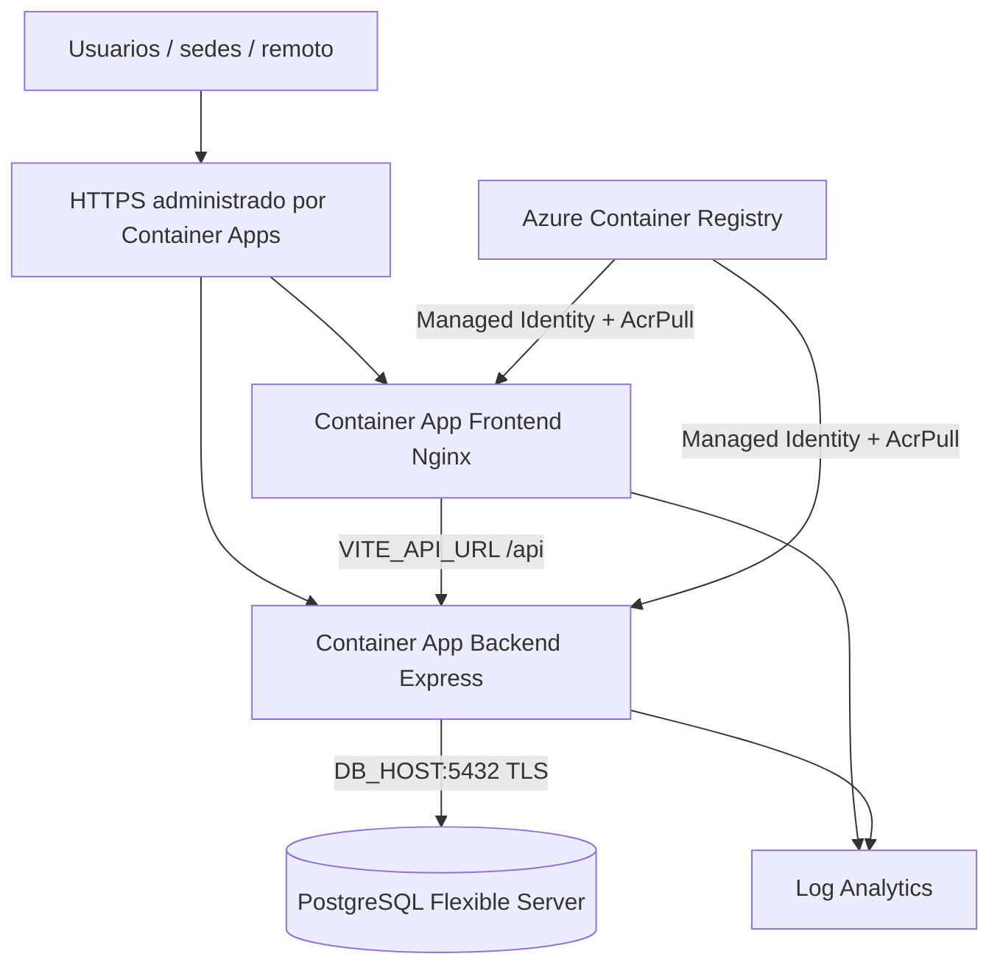

# Arquitectura de despliegue propuesta

El backend continúa siendo un monolito modular. RabbitMQ, el balanceador externo y Ollama permanente quedan fuera hasta contar con una integración y una decisión de costos validadas.

Flujo: crear ACR, publicar imágenes con tags inmutables, ejecutar `main.bicep`, inicializar PostgreSQL con el script seguro y probar healthchecks, sesión y persistencia.
