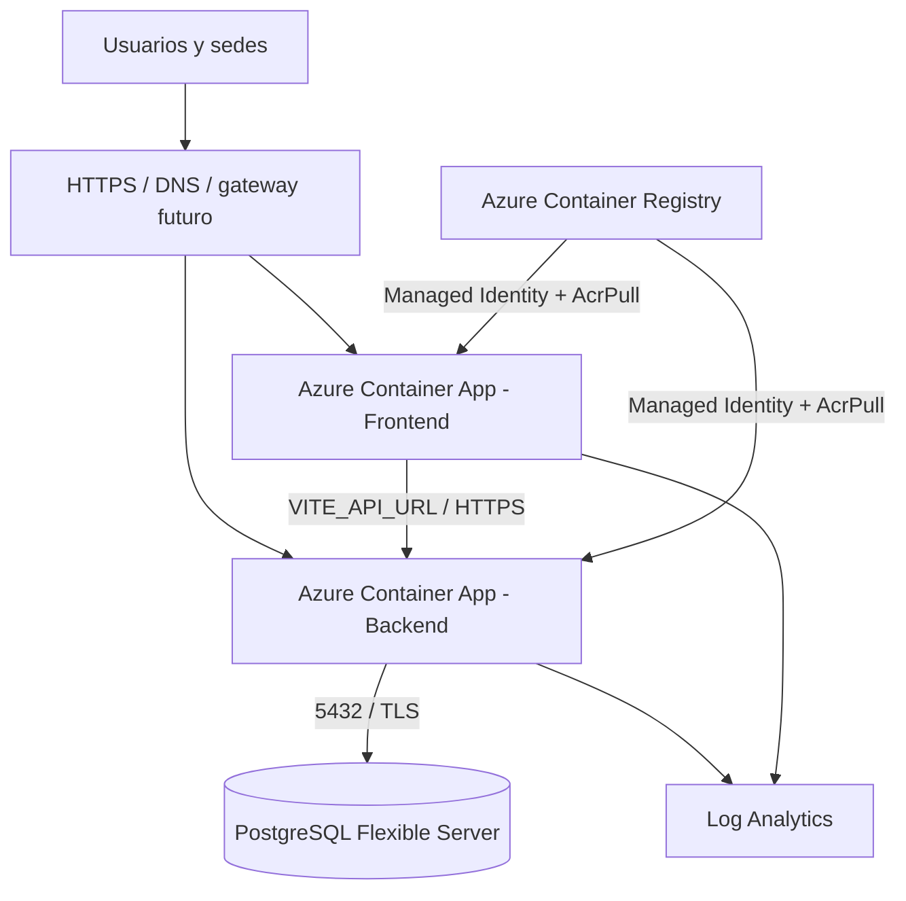

# Propuesta Azure — Nexus Safe-Cloud

Esta carpeta contiene infraestructura Bicep propuesta. No aprovisiona recursos por sí sola y no sustituye la validación en una suscripción Azure autorizada.

La solución conserva el monolito modular actual: frontend y backend son imágenes separadas, pero no se presentan como microservicios independientes.

## Arquitectura objetivo



## ACR e imágenes

Cada Container App usa una identidad administrada del sistema. `main.bicep` asigna a ambas identidades el rol integrado `AcrPull`; el usuario administrador del ACR permanece deshabilitado.

Flujo futuro: construir las imágenes con los Dockerfiles existentes, publicarlas con tags inmutables, pasar las referencias mediante `backendImage` y `frontendImage`, y actualizar la etiqueta para crear una nueva revisión.

Esta relación está declarada en Bicep, pero no se ha probado contra Azure.

## Topología y conectividad

La plantilla usa ingress HTTPS público de Container Apps para frontend y backend. El frontend llama al backend mediante la URL compilada en `VITE_API_URL`; el backend utiliza `FRONTEND_ORIGIN` para CORS.

El backend debe usar el FQDN de PostgreSQL Flexible Server:

```text
DB_HOST=<FQDN de PostgreSQL Flexible Server>
DB_PORT=5432
DB_NAME=nexuserpm
DB_USER=nexusadmin
DB_PASSWORD=<secreto>
```

La plantilla todavía no crea VNet, subred delegada, Private DNS Zone, Private Endpoint ni reglas de firewall. Por eso la conectividad PostgreSQL no está probada. Antes de producción debe elegirse acceso público restringido o conectividad privada mediante VNet compatible con Container Apps.

El gateway o balanceador externo del otro integrante queda fuera de esta plantilla.

## Variables y secretos

El backend conserva las variables reales del código: `NODE_ENV`, `PORT`, `FRONTEND_ORIGIN`, `SESSION_SECRET`, `DB_HOST`, `DB_PORT`, `DB_NAME`, `DB_USER`, `DB_PASSWORD`, `ADMIN_EMAIL`, `ADMIN_PASSWORD`, `ADMIN_NAME`, `DEMO_USERS_PASSWORD`, `LOAD_DEMO_DATA`, `OLLAMA_BASE_URL` y `OLLAMA_MODEL`.

`VITE_API_URL` se incorpora durante el build del frontend; no es una variable dinámica del contenedor Nginx. Las contraseñas y `SESSION_SECRET` se reciben como parámetros seguros y no deben almacenarse en Git ni en las imágenes. Para producción se recomienda Key Vault y un pipeline con federación de identidad.

## Escalabilidad

El backend tiene una regla HTTP basada en 50 solicitudes concurrentes por réplica, con mínimo 1 y máximo 2 réplicas en desarrollo. Es una configuración declarada, no una medición de capacidad.

El frontend es contenido estático servido por Nginx. Se mantiene entre 1 y 2 réplicas como margen operativo, pero no se ha definido una regla específica de carga. Los posibles cuellos de botella son PostgreSQL, el pool de conexiones del backend y las operaciones costosas de IA.

Los límites deben ajustarse después de pruebas de carga y observación de CPU, memoria, latencia y conexiones de base de datos.

## Resiliencia y recuperación

La propuesta declara backups de PostgreSQL con retención de 7 días, auto-growth de almacenamiento y logs centralizados. No declara ni prueba alta disponibilidad zonal, backup georredundante, failover entre regiones, restauración automatizada, RTO/RPO medidos, alertas, runbooks ni recuperación ante pérdida del entorno.

`highAvailability` y `geoRedundantBackup` permanecen deshabilitados en desarrollo para no asumir costos o disponibilidad no autorizados.

## Inicialización de PostgreSQL

`database/docker-init/01_init_schema.sql` puede reutilizarse con `psql`, pero sus rutas `/opt/nexus-sql/...` corresponden al montaje Docker. En Azure debe ejecutarse desde un job, pipeline o máquina autorizada que monte o copie `database/scripts/` en esa ruta. No debe ejecutarse al iniciar cada réplica.

## Ollama, RabbitMQ y balanceador

Ollama no debe usar `http://localhost:11434` desde Azure para alcanzar otro contenedor. Requiere un servicio separado y una URL accesible desde el backend; no se incluye aquí. RabbitMQ y el balanceador de carga tampoco se implementan en esta plantilla.

## Validación sin despliegue

```powershell
az bicep build --file infra/azure/main.bicep
```

Validación contra un grupo existente, sin crear recursos:

```powershell
az deployment group validate `
  --resource-group <grupo-existente> `
  --template-file infra/azure/main.bicep `
  --parameters infra/azure/main.dev.bicepparam `
  --parameters postgresAdminPassword='<valor-local>' `
    sessionSecret='<secreto-local-de-32-caracteres>' `
    adminPassword='<valor-local>' `
    demoUsersPassword='<valor-local>'
```

No ejecutar `az deployment group create` en esta etapa.

## Estado frente a RT2

| Componente | Estado |
|---|---|
| Docker Compose local | Implementado y probado previamente |
| ACR | Declarado; acceso por identidad administrada añadido, pendiente de validar en Azure |
| Container Apps | Declarado; despliegue no probado |
| PostgreSQL administrado | Declarado; red y conectividad pendientes |
| HTTPS e ingress | Declarados; dominio y pruebas pendientes |
| Escalamiento | Declarado; no probado bajo carga |
| Logs | Declarados; alertas y consultas pendientes |
| HA, failover y restore | Propuestos, no implementados ni probados |
| RabbitMQ y balanceador | Fuera de alcance hasta recibir integración validada |
